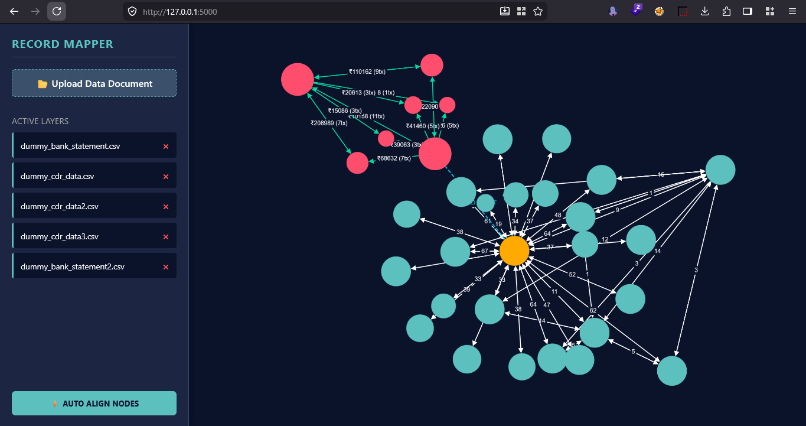
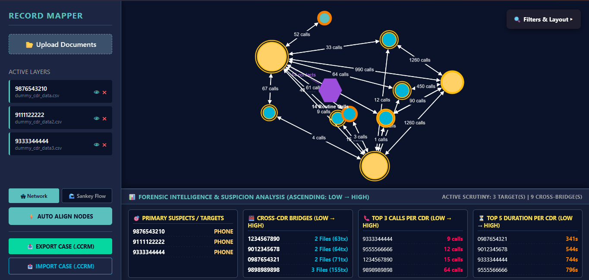
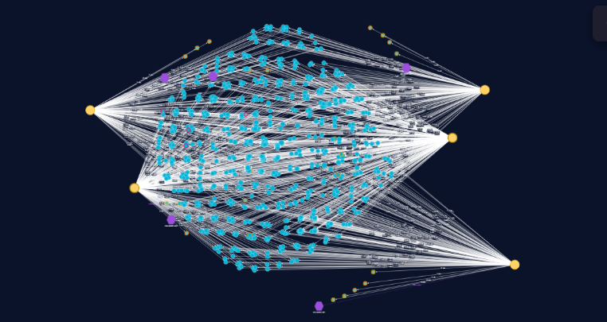

# Cyber Cell Record Mapper (CCRM) ⚡

An open-source, lightweight forensic link-analysis intelligence tool designed for local Cyber Cell units to automatically cross-examine and visualize multi-modal operational data sheets. 


<br>
[CCRM Interface Demo Video](/Demo/Demo.mp4)

By mapping **Telecom Call Detail Records (CDRs)** and **Financial Ledgers (UPI/IMPS Statements)** into a single interconnected network matrix, CCRM exposes structural patterns, hidden intermediaries, and money trails that go dark when scammers rotate burner communication lines.

---

## 🌟 Key Forensic Features

* **Multi-Modal Link Analysis:** Seamlessly renders telephone numbers (nodes), bank accounts/UPI strings (nodes), communication paths, and transactional wire vectors in a unified graph dashboard.
* **Batch Document Staging:** Supports uploading multiple tracking data files at once. The processing pipeline intelligently abstracts column headers from the primary document to apply the configuration globally across the entire batch.
* **Dynamic Schema-Agnostic Mapping:** Avoids rigid system column locks. Investigators use a drag-and-drop structural UI panel to map columns on the fly, ensuring full compatibility across varying service providers (JIO, Airtel) and banking layouts (SBI, HDFC).
* **Volatile In-Memory Processing:** Completely bypasses structural disk storage writes. Data files are parsed entirely inside volatile memory application streams, minimizing data leaks and forensic cross-contamination on host machines.
* **Custom Forensic Workspace Backups (.ccrm):** Save and resume your investigation anytime. Export active layers, graph structural memory, and pipeline configurations into a transportable standalone case backup with our custom .ccrm project extension.

---

## 🛠️ Architecture & Tech Stack

* **Backend Matrix:** Python Flask (Engineered with thread-isolated, volatile virtual memory abstractions)
* **Data Processing Layer:** Pandas DataFrames (Leveraging memory buffer I/O serialization)
* **Visualization Layer:** Cytoscape.js (COSE layout engine optimization for high-density networks)
* **Interface:** Responsive HTML5 / CSS3 Cyber Cell Dark Mode Protocol

---

## 🚀 Installation & Quick Start

### 1. Clone the Environment
Ensure Python 3.10+ is installed on your workstation:
<br>
```git clone https://github.com/yourusername/cyber-cell-record-mapper.git```
<br>
```cd cyber-cell-record-mapper```

### 2. Install Dependencies
Install optimized data serialization and routing requirements:
<br>
```pip install -r requirements.txt```
(Alternatively, install packages directly: pip install flask pandas)

### 3. Initialize Server
Launch the application on local port execution layer:
python app.py
Open your web browser and navigate to http://localhost:80 to initialize investigation mapping.

---

## 📂 Operational Workflow

1. **Stage Documents:** Click Upload Documents and select one or multiple .csv dumps (e.g., Target CDRs).
2. **Configure Pipeline:** 
   * Choose the operational mode (Telecom CDR or Financial Statement).
   * Drag discovered columns into their matching structural slots (Source, Target, Timestamp, etc.).
   * Click Process Batch to dynamically render your network topology.
3. **Link Assets:** When processing bank statement files, link the asset to an existing suspect mobile target inside the dropdown menu to trigger an automated blue Cross-Layer Link Edge across independent layout layers.
4. **Deep Inspection:** Tap any node (Phone or Bank) to pop open the Target Intelligence Log for an itemized, interactive ledger review.
5. **Backup Case File:** Click Export Case (.ccrm) to download a full snapshot of your current workspace session. Drop this file into Import Case (.ccrm) later to immediately restore the network layout without re-uploading individual files.

---

## 🔒 Forensic Safety Profile
* The tool implements volatile stream-based processing (io.StringIO), leaving zero remnant log footprints or temp file storage trails in the host machine's directory tree.
* Avoid server-restart data wipes during long operations by utilizing the localized workspace generation protocol (.ccrm).
 
---

## New Version Screenshots


With Real Data of ~10,000 Rows/Records:


---
Developed for practical deployment across regional cyber units and tactical police cells.